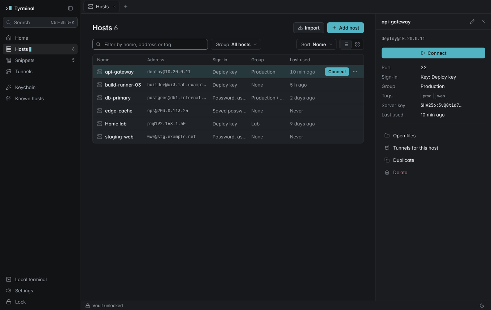

# Visual overhaul: plan

Status: proposal for the owner's review. Nothing in the app changes until this is approved and the
open feature PRs (#5, #7, #9, #10, #11, #12, #13, #15) have merged.

The brief: professional, clean, fast, simple where possible, with animation and good themes, and it
must not look generated. Termius is the reference for the feel: a calm, dense tool that gets out of
the way of the terminal.

What is in this change:

| Path | What |
|---|---|
| `docs/design/overhaul.md` | This plan |
| `docs/design/before/` | The current UI, every main screen in dark and light, plus PR #5 (`pr5-*`) and PR #7 (`pr7-*`) where they differ from main |
| `docs/design/after/` | Screenshots of the prototype, same viewport (1360×860) |
| `docs/design/prototype/` | The static prototype (`index.html?screen=hosts&theme=dark&palette=fjord`), its sketch CSS, icon sprite and screenshot script |
| `apps/desktop/src/styles/next/theme.css` | New tokens and the six themes. **Not imported by the app yet** |
| `apps/desktop/src/styles/next/motion.css` | Motion tokens and utilities. **Not imported yet** |
| `scripts/check-theme-contrast.mjs` | WCAG AA check for all six themes (678 pairs, passing) |
| `tests/ui/design-capture.ts` + `design-capture.config.ts` | Re-takes the before screenshots from the real UI build. Not part of the suite (it matches `*.spec.ts` only) |

No new dependencies. No bundled font (system UI face, so no ADR is needed). The terminal colour
schemes are untouched.

---

## 1. Audit

Method: the production UI build with the mock backend (`tests/ui/fixtures.ts`), every main screen
in both themes, then a pass against the `frontend-design` tells list, the `taste-skill`/
`redesign-skill` audit, `ui-ux-pro-max` (interaction, focus, desktop) and the motion standards in
`review-animations/STANDARDS.md`. PR #5 and PR #7 were built and captured the same way.

The base is sound: tokens exist, contrast is checked in CI, focus is visible, every list has empty,
loading and error states, reduced motion is respected. The problems are in the visual defaults, and
almost all of them are the ones the skills list as generated-looking.

### 1.1 Generated-looking tells

| # | Tell | Where | Screens |
|---|---|---|---|
| T1 | Gradient and glow decoration: radial accent and green washes behind the whole app (`--app-backdrop`), a dot grid and two glows behind onboarding, an accent glow on focused fields, a gradient brand tile, gradient avatar tiles | Shell, onboarding, unlock, fields, sidebar | `before/dark-onboarding.png`, `before/dark-unlock.png` |
| T2 | Tinted near-black canvas: `#080b10` (navy black) as the dark base, with a single bright blue accent | Dark theme everywhere | `before/dark-home.png` |
| T3 | Default SaaS blue as the accent: `#6c9cff` dark, `#2563eb` light (the Tailwind blue-600 value) | Primary buttons, selection, links | `before/light-hosts-list.png` |
| T4 | Tracked-out ALL-CAPS eyebrow labels: LIBRARY, SESSIONS, START, KEYBOARD, and every palette group | Sidebar, Home, palette | `before/dark-home.png`, `before/dark-palette.png` |
| T5 | Two-letter initials in coloured rounded tiles as host "avatars" (AG, BR, DP...) | Home, Hosts, palette | `before/dark-hosts-grid.png` |
| T6 | The card kit: everything is an identical rounded card with a border, cards inside cards (Home "Start" panel), a card per settings section, a card per snippet | Home, Hosts grid, Settings, Snippets | `before/dark-home.png`, `before/dark-settings.png`, `before/dark-snippets.png` |
| T7 | `→` appended to links and list rows ("View all 6 →", every recent connection) | Home | `before/dark-home.png` |
| T8 | Middle-dot meta strings joining four or five facts ("deploy@10.20.0.11 · Key: Deploy key · Production · prod, web"; "Local · encrypted") | Hosts list, Keychain, status bar | `before/light-hosts-list.png`, `before/dark-keychain.png` |
| T9 | Generic empty state: an icon in a glossy tile inside dashed concentric rings, centred, with a centred button | Tunnels, Hosts, Snippets, Keychain empty | `before/dark-tunnels-empty.png` |
| T10 | Chip overuse: tags, sign-in method and "Last used" all drawn as pills, so nothing stands out | Hosts cards | `before/dark-hosts-grid.png` |
| T11 | Blur behind every modal (`backdrop-filter`), which also costs a full-window repaint while open | Dialogs, palette | `before/dark-host-editor.png` |
| T12 | Spring overshoot on toasts and a fade-and-rise on every page change | Toasts, all pages | motion audit below |
| T13 | Triple key caps for every shortcut (`Ctrl` `Shift` `K` as three boxes), repeated in the sidebar, Home, panels and palette | Everywhere | `before/dark-home.png` |
| T14 | Ellipsis on labels that open nothing ("Search...", "Upload...", "Download this folder...") and "Show / hide" in command names | Sidebar, Files, palette | `before/dark-terminal-files.png` |

### 1.2 Inconsistencies

| # | Finding | Evidence |
|---|---|---|
| I1 | **Page width jumps.** Home and Hosts start at the content edge and fill the width; Keychain (836 px), Snippets (796 px) and Tunnels (896 px) are centred columns of different widths, so the title moves on every navigation | `before/dark-home.png` vs `before/dark-keychain.png` vs `before/dark-snippets.png` |
| I2 | **Icon sizes**: 12 distinct sizes in use (11, 12, 13, 14, 15, 16, 17, 18, 19, 26, 28, 30 px), sidebar icons 17, row icons 15, panel icons 14 | `grep 'size={'` over `src/` |
| I3 | **Radii**: tokens 4/6/8/12/16 plus 13 hard-coded radii in `global.css` (2, 3, 7, 9, 10, 20, 22 px). Buttons, inputs, cards and dialogs look like one radius scaled up | `global.css` |
| I4 | **Type scale**: seven sizes (11 to 26) with non-standard weights (450/550/620/680) that system faces round to the nearest static weight, so Windows and macOS render different hierarchies | `tokens.css` |
| I5 | **Shadows**: 42 `box-shadow` declarations; flat cards carry the same grey shadow as floating menus, so elevation carries no meaning | `global.css` |
| I6 | **Terminal edge**: the pane is darker than the terminal background in dark (a black strip under the last row) and the terminal sits inset with a margin on the light app, so it looks pasted in | `before/dark-terminal-files.png`, `before/light-terminal-snippets.png` |
| I7 | **Primary button weight**: in dark the primary fill is a light blue with dark text, and disabled primaries become a washed-out blue that reads as enabled (Snippets with no terminal) | `before/dark-snippets.png` |
| I8 | **Monospace for labels**: fine for addresses and fingerprints (real machine text), but also used for group paths and counts in the palette | `before/dark-palette.png` |
| I9 | **Group filters on Hosts** are pills with a separate `...` button between each, which reads as stray dots | `before/dark-hosts-grid.png` |
| I10 | **Status bar** carries developer detail (renderer, cipher) next to user-level status; PR #9 adds a connection details view where it belongs | `before/dark-terminal.png` |
| I11 | **Files panel**: four text buttons wrap onto two rows and two switches take a third, before the first file | `before/dark-terminal-files.png` |
| I12 | **Copy tone**: mostly plain and good. Exceptions: "Show / hide snippets panel", "Not used by any host · Passphrase stored", "Everything stays on this device." repeated under a sentence that already said it | Home, Keychain, onboarding |

### 1.3 Motion audit

| Animation | Today | Verdict |
|---|---|---|
| Page change | `page-in` 260 ms fade and rise on every navigation | Remove. Navigation happens tens of times an hour; the animation makes it feel slower (frequency rule) |
| Sidebar collapse | `grid-template-columns` transition | Layout property, reflows the terminal every frame. Make it instant |
| Dialog | 260 ms scale from 0.98 with blur behind | Keep the shape, shorten to 180 ms, drop the blur |
| Command palette | Same as dialogs | Opened from the keyboard hundreds of times a day: no animation (the Raycast rule) |
| Menus | 180 ms from -4 px | Keep, 140 ms, grow from the trigger |
| Toasts | 260 ms with a spring overshoot (`cubic-bezier(0.3, 1.3, 0.5, 1)`) | No overshoot; 220 ms ease-out rise, fade out faster |
| Skeleton | Shimmer sweeping `background-position` | Paints every frame. Replace with a still tint |
| Side panels | 260 ms slide from 12 px, `@keyframes` (not interruptible) | 180 ms from 8 px as a transition, interruptible |
| Hover on cards | Background and border transitions everywhere | Keep colour only, 100 ms |
| Busy dots, spinner | Loop | Keep only for real waiting; stop under reduced motion (already true) |

PR #7 adds 248 lines of CSS (tab status, layouts, detach) and PR #5 adds 122 (identities, keys,
presentation); both follow the current card and pill patterns, so they inherit every finding above
and need no separate treatment once the system lands (`before/pr5-*`, `before/pr7-*`).

---

## 2. Direction

**A quiet instrument with one live element: the cursor.**

Everything in Tyrminal ends at a prompt. The one memorable thing is the block cursor: a small solid
block, the accent colour, that marks where you are. It sits after the label of the current sidebar
item and the current settings section, and in the wordmark. When the window loses focus it turns
hollow, the way a terminal's cursor does. It never blinks (the real terminal cursor keeps the user's
own blink setting). That is the whole of the brand in the UI.

Everything else is quiet and disciplined:

- **Graphite and paper neutrals**, one grey family, no tinted near-black. Colour means state:
  green connected, amber attention, red danger, the accent for the current thing and the primary
  action. No decorative colour, gradient, glow, texture or blur anywhere.
- **Flat surfaces; borders separate, shadows float.** Lists are tables with hairlines, not decks of
  cards. Only menus, dialogs, the palette and toasts have a shadow.
- **One page column**, left-aligned at the same gutter on every screen, capped at 1080 px. The title
  never moves between screens.
- **Dense, aligned type**: five sizes, three weights, tabular numbers, mono only for machine text.
- **Fast motion that answers the pointer**; nothing moves on its own, nothing opened from the keyboard
  animates, and the terminal never animates.

### Review against the brief (the two-pass check)

The first draft had three choices that were defaults rather than decisions. They were changed:

1. *Keep blue and tune it.* Blue would have kept tell T3. Changed to a teal-cyan accent (dark
   `#52b4c3`, light `#0b7184`): the colour of a shell prompt, distinct from every status colour, and
   not the SaaS default.
2. *Bundle Inter.* Inter on everything is itself a listed tell, and a bundled UI face makes the app
   feel foreign on each OS. Changed to the system UI face (SF Pro, Segoe UI Variable, the desktop face
   on Linux). Nothing to bundle, no ADR. The mock-ups render in Inter only because the screenshot
   machine is Linux; that is noted in `prototype/prototype.css`.
3. *Coloured status dots everywhere.* Dots now appear only where they carry live session state (tabs,
   sessions list, status bar), never as decoration.

Checked against the frontend-design calibration list: not cream with serif, not near-black with an
acid accent, not hairline broadsheet, not the card kit, no eyebrows, no middle-dot chains, no tinted
`#0B0B0B`, no `→` suffixes, mono only for data.

---

## 3. Tokens

All values live in `apps/desktop/src/styles/next/theme.css`. Names that already exist in
`tokens.css` keep their meaning, so Stage B swaps the file and then fixes components. Run
`node scripts/check-theme-contrast.mjs --report` to see the lowest ratio per theme.

### 3.1 Themes

Two attributes on the root: `data-theme` (dark or light, resolved from System as today) and
`data-palette` (absent for the standard pair, `fjord`, or `contrast`). Every palette has both modes,
so "System" keeps working with any of them. Settings shows the palette as three swatches and the
mode as a segmented control (`after/dark-settings.png`).

| Token | Graphite (dark) | Paper (light) | Fjord dark | Fjord light | Contrast dark | Contrast light |
|---|---|---|---|---|---|---|
| `--bg-app` | `#16181b` | `#fbfbfc` | `#191e27` | `#f7f9fb` | `#000000` | `#ffffff` |
| `--bg-sidebar` | `#111315` | `#f2f3f5` | `#141821` | `#edf0f4` | `#000000` | `#ffffff` |
| `--bg-surface` | `#1a1c20` | `#f6f7f8` | `#1d222c` | `#f2f4f7` | `#0a0a0a` | `#ffffff` |
| `--bg-raised` | `#1f2226` | `#ffffff` | `#222833` | `#ffffff` | `#101010` | `#ffffff` |
| `--bg-overlay` | `#222529` | `#ffffff` | `#262c37` | `#ffffff` | `#101010` | `#ffffff` |
| `--bg-inset` | `#121416` | `#eff0f2` | `#151920` | `#e9edf2` | `#000000` | `#f2f2f2` |
| `--text` | `#e7e9ec` | `#16191d` | `#e5e9f0` | `#1b2230` | `#ffffff` | `#000000` |
| `--text-muted` | `#a5aab2` | `#4d535b` | `#a9b2c1` | `#4a5466` | `#dadada` | `#262626` |
| `--text-faint` | `#8e949d` | `#5d636c` | `#939cac` | `#5a6476` | `#c4c4c4` | `#3b3b3b` |
| `--accent` | `#52b4c3` | `#0b7184` | `#88c0d0` | `#2e6894` | `#ffd65c` | `#0040a0` |
| `--accent-text`, `--focus`, `--cursor` | `#7ccfda` | `#08687a` | `#93c8d7` | `#285f88` | `#ffd65c` | `#00358a` |
| `--success` | `#5ccb8f` | `#14774a` | `#a3c98a` | `#346d26` | `#6ff0a8` | `#00602e` |
| `--warning` | `#e3b45a` | `#875800` | `#e8c47c` | `#84590a` | `#ffb86b` | `#6b4100` |
| `--danger` | `#f07b7b` | `#be2a30` | `#e5878f` | `#b03a46` | `#ff8f8f` | `#a1000b` |

- **Graphite / Paper** (default): neutral greys with a faint cool cast, teal-cyan accent.
- **Fjord**: blue slate with a frost accent, closest to Termius' own feel, for people who want a
  softer, cooler dark.
- **High contrast**: pure black and white with thick borders and a yellow (dark) or deep blue (light)
  accent, for low vision and bright rooms. It is the one place pure black is right. Under Windows
  contrast themes (`forced-colors`), system colours win and the focus ring and cursor use `Highlight`.

Every pair the current CI check covers is checked in all six (text and status on every surface,
control boundary 3:1, focus ring 3:1, accent fill 3:1, cursor 3:1, text on hover/selected states,
badges on their soft fills, primary button text). The lowest text ratio is 4.84 (Graphite faint text
on a hovered raised row). The terminal scheme stays independent: changing the app theme never
changes the terminal, as today.

### 3.2 Type

| Token | Size / line | Use |
|---|---|---|
| `--text-xs` | 11 / 14 | Shortcut hints, the rare caption |
| `--text-sm` | 12 / 16 | Secondary lines, meta, column headers, status bar |
| `--text-md` | 13 / 18 | Everything else (body, controls, rows) |
| `--text-lg` | 15 / 20 | Section and dialog titles |
| `--text-xl` | 20 / 26 | The page title, once per screen |

Weights 400, 500, 600 only (real static weights on every OS). Titles get `-0.011em` tracking.
Counts, sizes, times and percentages use tabular numbers. JetBrains Mono (bundled, OFL, already in
the app) only for machine text: addresses, ports in addresses, paths, fingerprints, commands,
permissions. Sentence case everywhere; no uppercase labels.

Hierarchy comes from weight and colour, not size: a page has one 20 px title, and everything below
it is 13 or 12.

### 3.3 Space, size, radius, elevation, focus

- **Space**: 4 px grid (`--space-1` 4 ... `--space-7` 48), plus `--space-0` 2 px for optical nudges.
  Page gutter 32, sections 24 apart, rows 36 (one line) or 48 (two lines), controls 30 (24 small).
- **Layout**: sidebar 224 (52 collapsed), tab strip 38, status bar 26, side panel 320, page column
  max 1080, left-aligned.
- **Radius by hierarchy**, capped at 10 so nothing looks like a phone app:

  | Token | px | For |
  |---|---|---|
  | `--radius-inner` | 3 | Key hints, checkboxes, tags, the cursor |
  | `--radius-control` | 6 | Buttons, inputs, rows, tabs, menu items |
  | `--radius-panel` | 8 | Grouped lists, menus, popovers, toasts |
  | `--radius-dialog` | 10 | Dialogs, the palette |
  | `--radius-round` | full | Switches and status dots only |

- **Elevation**: level 0 is flat with a 1 px border (lists, panels, cards that earn a container).
  `--shadow-1` for menus, popovers and toasts; `--shadow-2` for dialogs and the palette. Shadows are
  tinted with the neutral hue and carry a 1 px ring so they read in dark mode. No blur behind modals;
  the scrim is a flat tint.
- **Focus**: one ring everywhere, `outline: 2px solid var(--focus)` at 2 px offset, never a glow.
  Outline (not box-shadow) so Windows contrast themes keep it. At least 3:1 on every surface.
- **Icons**: the existing Lucide subset stays (swapping sets is churn with no user benefit), but at
  one size, 16 px (14 px inside small controls), stroke 1.5 instead of 1.75. Twelve sizes become two.
- **Layers**: a z-index scale (`--z-sticky` 10 ... `--z-tooltip` 60) instead of ad hoc values.

---

## 4. Motion

Tokens and utilities: `apps/desktop/src/styles/next/motion.css`.

| Token | Value | For |
|---|---|---|
| `--duration-press` | 100 ms | Press feedback, hover colour |
| `--duration-fast` | 140 ms | Tooltips, menus, popovers, every exit |
| `--duration-base` | 180 ms | Dialogs, side panels |
| `--duration-slow` | 220 ms | Toasts, first-run sheets. The ceiling |
| `--ease-out` | `cubic-bezier(0.23, 1, 0.32, 1)` | Anything entering or answering |
| `--ease-in-out` | `cubic-bezier(0.77, 0, 0.175, 1)` | Something moving across the screen |
| `--ease-drawer` | `cubic-bezier(0.32, 0.72, 0, 1)` | Side panels |

**What animates** (all transform and opacity, all as CSS transitions with `@starting-style`, so they
are interruptible and need no JavaScript):

| Element | Motion | Utility |
|---|---|---|
| Buttons, rows you press | `scale(0.98)` while pressed, 100 ms | `.m-press` |
| Hover | Background and colour only, 100 ms | `.m-hover` |
| Menus, popovers | Opacity and `scale(0.97)` from the trigger corner, 140 ms | `.m-pop` (set `--origin`) |
| Tooltips | Opacity after the delay; instant once one is showing | `.m-tip` |
| Dialogs | Opacity and `scale(0.98)` with 4 px rise, 180 ms; scrim fades | `dialog.m-dialog` |
| Files, Snippets, host details panels | 8 px slide from their edge plus opacity, 180 ms | `.m-panel` |
| Toasts | 8 px rise plus opacity, 220 ms; leave by fading, 140 ms | `.m-toast`, `.m-leaving` |
| Disclosure (a group expanding) | Opacity and 2 px drop, 140 ms | `.m-reveal` |
| A session connecting | Its dot breathes (opacity), the only loop | `.m-connecting` |

**What never animates**: terminal output, the terminal cursor, terminal resize and split dividers,
tab switching, page changes, the sidebar collapse, the command palette and anything else opened from
the keyboard (mark the surface `data-opened-by="keyboard"`), the host key changed warning (danger
stays still), and loading placeholders (a still tint, no shimmer).

**Reduced motion**: the OS setting or the in-app switch sets every duration to 0, removes the press
scale and stops the connecting loop. The UI tests already run with reduced motion, so baselines are
unaffected by motion.

**Performance**: only composite properties move, so nothing reflows the terminal. `will-change` is not
used up front (`animation-performance` skill: add it only to fix measured jank).

---

## 5. Per screen

Before images are the current main branch; after images are the prototype. The prototype is a sketch
of layout and tokens with synthetic data, not a pixel contract.

### App shell, sidebar, tabs, status bar

Before: `before/dark-home.png` · After: `after/dark-home.png`, `after/dark-hosts-window-blurred.png`

- Remove the app backdrop gradients. Sidebar on `--bg-sidebar` with a single hairline.
- Wordmark: `>` plus the cursor in mono next to "Tyrminal"; replaces the gradient tile in the UI
  (the app icon itself is out of scope here).
- Collapse control moves to the wordmark row as an icon button.
- Search: one field with a single "Ctrl+Shift+K" hint (Cmd K on macOS), no triple key caps.
- Nav: current item has the active fill and the cursor after its label. Groups are separated by a
  12 px gap instead of a LIBRARY label; "Sessions" stays as a sentence-case heading because it names
  a live list. Bottom: Local terminal, Settings, Lock.
- Tabs: flat, 30 px, the active tab takes the page colour so it joins the content. Close button shows
  on the active and hovered tab. Status dot only on session tabs.
- Status bar: connection state, `user@host`, size. Renderer and cipher move to the connection
  details view (PR #9). Files, Snippets and Details toggles on the right.

### Home

Before: `before/dark-home.png`, `before/dark-home-empty.png` · After: `after/dark-home.png`

- One quick-connect field (`user@host:port`, or a saved host's name), Enter to connect.
- "Recent" as a table (name, address, when), not a card grid; no `→` on rows.
- "Start" as a plain list of five actions with their shortcuts. The keyboard shortcuts card goes (the
  palette lists every shortcut).
- The duplicated Hosts grid on Home goes; "All hosts" links to Hosts.

### Hosts and the host side panel

Before: `before/dark-hosts-grid.png`, `before/dark-hosts-list.png`, `before/pr5-dark-hosts-grid.png`
· After: `after/dark-hosts.png`, `after/light-hosts.png`, `after/dark-toast.png`

- List is the default view: a dense table (Name, Address, Sign-in, Group, Last used) with Connect and
  the row menu on hover or selection. Cards remain as an option, flat, without pills.
- Initials avatars go; a neutral server icon (later: the host's OS or protocol) instead.
- Group filter becomes a "Group" select; sort a "Sort" select; view toggle two icons. PR #5's
  Address and Group sorts fit the same select.
- Selecting a row opens the host side panel: address, a full-width Connect, a fact list (port,
  sign-in, group, tags, server key, last used) and actions (Open files, Tunnels for this host,
  Duplicate, Delete). Edit is the pencil in its header.
- Row menu: Connect, Connect in split, Open files, Edit (F2), Duplicate, Delete (Del).

### Host editor and other dialogs

Before: `before/dark-host-editor.png` · After: `after/dark-trust.png` (dialog pattern)

- No icon tile in dialog headers. Title 15/600, one explanatory sentence, fields, actions right-aligned
  in the order Cancel (ghost), secondary, primary.
- Host editor in two groups (Connection: name, address, port, user, protocol; Sign-in: method and key)
  with protocol details, encoding and terminal type under an "Advanced" disclosure, so the default
  dialog fits without scrolling.
- Flat scrim, no blur.

### Terminal chrome

Before: `before/dark-terminal.png`, `before/light-terminal-snippets.png`, `before/pr7-dark-terminal.png`
· After: `after/dark-terminal.png`, `after/fjord-dark-terminal.png`

- The pane background is the terminal scheme's background, edge to edge, so there is no strip under
  the last row and no inset frame in light mode. Padding stays inside the terminal colour.
- Split dividers are 1 px `--border` lines with an 8 px hit area.
- Nothing in or around the terminal animates.

### Files (SFTP)

Before: `before/dark-terminal-files.png` · After: `after/dark-terminal.png`

- Header with icon buttons (Upload, New folder, View options, Close), each with a tooltip and
  accessible name; Download and Upload folder go into the Upload menu and the row menu.
- "Show hidden files" and "Show this computer" move into View options.
- Path bar: Up, the path in mono, Refresh. Rows 28 px: icon, name, size (tabular), permissions (mono,
  faint).
- Transfers as a compact block with a 3 px bar and "31 of 50 MB, 12 MB/s".

### Snippets

Before: `before/dark-snippets.png`, `before/light-terminal-snippets.png`

- Library page as a table grouped by folder (name, first line of the command in mono, line count),
  Run and Paste on hover; editing in the side panel. No card per snippet.
- The "Open or select a terminal" notice becomes the disabled state's tooltip and a single line under
  the title, and disabled Run buttons look disabled (`--bg-active`, `--text-faint`), not washed blue.
- Panel version: same rows at 28 px, the target ("Sends to api-gateway") as one line at the top.

### Keychain and Known hosts

Before: `before/dark-keychain.png`, `before/pr5-dark-keychain.png`, `before/dark-known-hosts.png`

- Tables: name, type, fingerprint (mono, truncated in the middle), used by. Copy public key and Add
  certificate (PR #5) on hover and in the row menu; Delete only in the menu.
- Identities (PR #5) as a second table on the same page under a 15 px heading, with its own empty row.
- Known hosts: server, key type, fingerprint, first seen; a changed key shows a red "Changed" tag.

### Tunnels and Recordings

Before: `before/dark-tunnels.png`, `before/dark-tunnels-empty.png`

- Active and Saved as two tables on one column; a running tunnel shows a green dot and its local
  address in mono. Start and Stop on the row.
- Recordings (PR #11) follows the same table pattern: session, host, started, length, size.

### Settings

Before: `before/dark-settings.png`, `before/dark-settings-terminal.png` · After: `after/dark-settings.png`,
`after/light-settings.png`

- No card per section. A left sub-nav (with the cursor on the current section) and plain groups of
  rows separated by hairlines.
- Appearance: Mode (System, Light, Dark), Theme (three swatches that show the current mode), Reduce
  motion.
- The terminal preview keeps its live xterm; scheme swatches become a compact list with the preview
  beside it.

### Unlock and onboarding

Before: `before/dark-onboarding.png`, `before/dark-unlock.png` · After: `after/dark-unlock.png`,
`after/light-unlock.png`

- No card, dot grid or glows: a 340 px column on the app background with the wordmark, a title, the
  passphrase field and one button. The recovery key link under it.
- Onboarding uses the same column; the irreversible-loss warning stays as an amber notice.

### Command palette

Before: `before/dark-palette.png` · After: `after/dark-palette.png`

- Groups in sentence case (Snippets, Hosts, Commands), rows 32 px, match highlight in the accent
  text colour, shortcut as one quiet string. Opens with no animation.

### Toasts, menus, empty states, notices

After: `after/dark-toast.png`, `after/light-toast.png`, `after/dark-empty.png`

- Toasts bottom-right above the status bar, 340 px, status icon, one line, an optional action
  ("Reconnect"). No exclamation marks.
- Empty states are left-aligned in the page column: a 15 px heading, one sentence on what to do, the
  real action. On Hosts the action is the quick-connect field plus Add host and Import from SSH config.
  No illustration tiles.
- Notices (info, warning, danger) as a 3 px left edge in the status colour on the soft fill; danger
  notices for a changed host key keep their full explanation.

### Copy rules

- Sentence case; no ALL CAPS, no `→`, no em dashes, at most one middle dot on a line.
- An ellipsis only when the control opens something that asks for more input.
- Commands name the thing, not the toggle: "Files panel", not "Show / hide files (SFTP)".
- Buttons say what happens; the toast uses the same verb ("Copy public key" then "Copied public key").
- Errors say what failed and what to do, without apology.

---

## 6. Implementation order (Stage B)

Starts after the feature PRs merge. One area per PR so each merges quickly. Every PR keeps the
contrast check, axe and all UI tests green and re-records the visual baselines it changes in the
pinned container (`pnpm test:ui:update:container`), saying why in the PR.

1. **Foundations**: replace `tokens.css` with `next/theme.css`, import `next/motion.css`, fold
   `check-theme-contrast.mjs` into `check-contrast.mjs` (CI already runs it), add the palette setting
   (`data-palette`) next to Mode, remove the app backdrop, page-in, shimmer, sidebar width transition
   and modal blur. Map old token names that go away (`--text-2xs`, `--text-2xl`, `--radius-dialog` 16)
   to the new scale. Expect most baselines to move; this is the one large baseline update.
2. **Shell**: sidebar (cursor marker, groups, search), tab strip, status bar, focus ring, icon sizes
   and stroke.
3. **Primitives**: buttons, fields, selects, segmented, switch, tags, menus, tooltips, dialogs,
   toasts, notices, empty state, and a shared table/row component for every list below.
4. **Home**.
5. **Hosts and the host side panel**, then the host editor.
6. **Terminal chrome and Files**.
7. **Snippets** (page and panel).
8. **Keychain and Known hosts**.
9. **Tunnels and Recordings**.
10. **Settings** (Appearance with the theme picker, then the other sections).
11. **Unlock and onboarding**.
12. **Command palette** and a final sweep of copy against the rules above.

After step 1 the app already looks consistent (tokens drive most of it); steps 2 to 12 remove the
patterns. `docs/design-system.md` is updated in step 1 and again as primitives change.

---

## 7. Questions for the owner

1. **Accent**: teal-cyan as proposed, or keep a blue (it would be a deeper, less default blue than
   today's)?
2. **Extra themes**: Fjord and High contrast, both with light and dark. Is a third wanted (for
   example a warm grey)?
3. **Home**: agree to drop the hosts grid and the keyboard card from Home?
4. **Hosts default view**: list (table) as the default, cards as an option?
